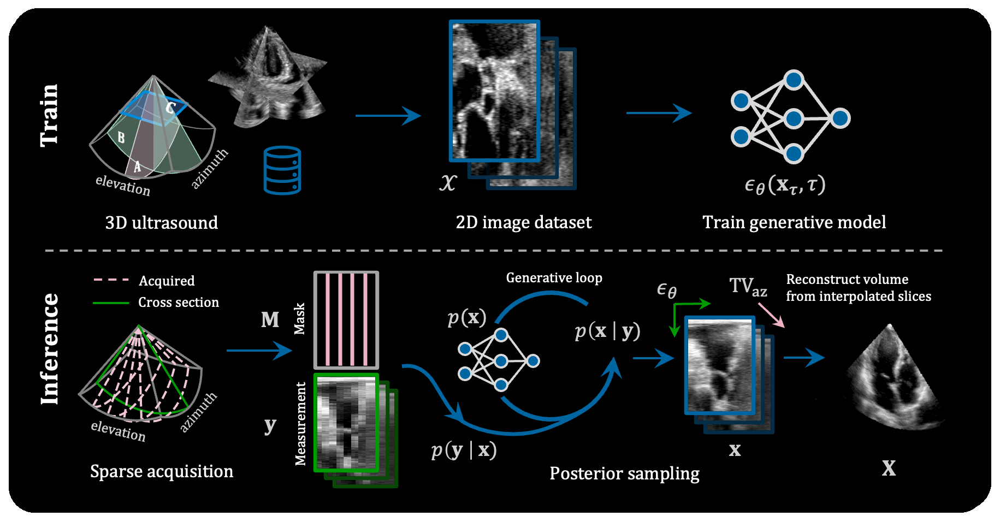
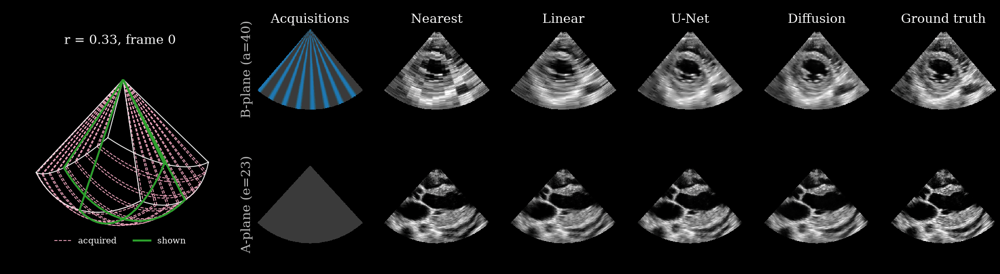
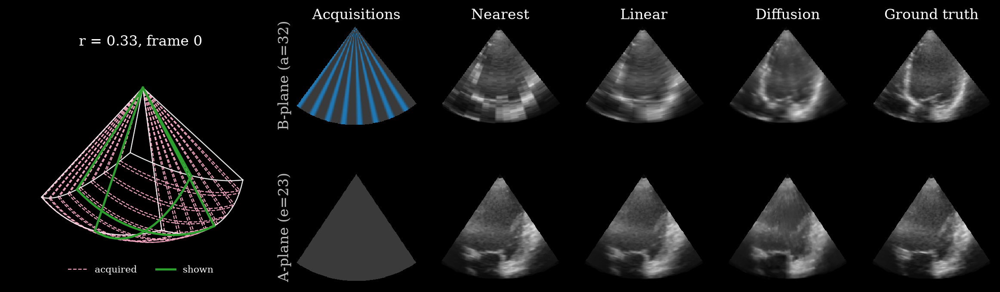

<div align="center">

# High Volume Rate 3D Ultrasound Reconstruction with Diffusion Models

[**Tristan S. W. Stevens**](https://tristan-deep.github.io/)<sup>1</sup>, [**Oisín Nolan**](https://oisinnolan.github.io/)<sup>1</sup>, [**Oudom Somphone**](https://www.researchgate.net/profile/Oudom-Somphone)<sup>2</sup>, [**Jean-Luc Robert**](https://scholar.google.com/citations?user=BrY9ygYAAAAJ&hl=fr)<sup>2</sup>, [**Ruud J. G. van Sloun**](https://www.tue.nl/en/research/researchers/ruud-van-sloun)<sup>1</sup>

<sup>1</sup>Eindhoven University of Technology &nbsp;&nbsp; <sup>2</sup>Philips Research

*IEEE Transactions on Medical Imaging, 2025*

[](https://3d-ultrasound-diffusion.github.io/)
[](https://arxiv.org/abs/2505.22090)
[](https://ieeexplore.ieee.org/document/11303954)
[](https://github.com/tue-bmd/zea)



</div>

Official repository for the paper *"High Volume Rate 3D Ultrasound Reconstruction with Diffusion Models"*.

3D ultrasound offers real-time volumetric imaging, but achieving both high volume rates and high image quality remains challenging. Diverging waves enable high volume rates at the cost of image quality, while maintaining focusing in elevation requires heavily undersampling the elevation planes to reach comparable volume rates. We propose to reconstruct the missing elevation planes with diffusion models. The method consists of three components, each acting along one of the dimensions of the 4D data (depth × azimuth × elevation × time):

1. **2D diffusion prior (elevation).** A diffusion model trained on B-planes (depth × elevation) fills in the missing elevation planes through diffusion posterior sampling ([train.py](train.py), [inference.py](inference.py)).
2. **TV prior (azimuth).** A total-variation prior across neighbouring B-planes keeps the reconstructed volume consistent along azimuth ([guidance.py](guidance.py)).
3. **SeqDiff (time).** Each frame is initialized from the reconstruction of the previous frame, so every volume needs only a fraction of the diffusion steps ([seqdiff.py](seqdiff.py); Stevens et al., [ICASSP 2025](https://arxiv.org/abs/2409.05399)).

## Results

Reconstruction of an in-vivo 3D cardiac sequence from the paper's test set, with one third of the elevation planes acquired (r = 0.33). The 3D frustum on the left shows the acquired elevation planes (dashed) and the two displayed cross sections (solid): a B-plane (depth × elevation) and an A-plane (depth × azimuth) at a non-acquired elevation. The animation runs over the frames of the sequence, reconstructed with SeqDiff. Note that A-planes are either fully acquired or fully reconstructed, while B-planes are partially acquired and partially reconstructed.



## Built with zea

This code is built on [**zea**](https://github.com/tue-bmd/zea) ([docs](https://zea.readthedocs.io)), a toolbox for cognitive ultrasound imaging, with the [JAX](https://docs.jax.dev) backend. zea provides the generative modeling infrastructure, including posterior sampling as well as the ultrasound signal processing pipeline and data handling (including streaming datasets from the Hugging Face Hub). For a simplified 2D version of this approach, i.e. diffusion posterior sampling of a single subsampled image, see the zea [diffusion model example](https://zea.readthedocs.io/en/latest/notebooks/models/diffusion_model_example.html).

> [!NOTE]
> The in-vivo 3D dataset and the trained model weights from the paper are not publicly available. This repository therefore starts from scratch: (1) train the diffusion prior on your own 3D data, then (2) use it to reconstruct subsampled volumes.

## Installation

Use Linux (or WSL2) with an NVIDIA GPU. Install [uv](https://docs.astral.sh/uv/), then:

```bash
uv sync
```

This creates `.venv` with zea, JAX (CUDA 12) and the other dependencies. Run scripts with `uv run python <script>.py`, or activate the environment first. A [dev container](.devcontainer/devcontainer.json) with the same setup is included.

Paths to data, models and results can be set with command line flags or in a `.env` file (see [.env.example](.env.example)).

## Data

The scripts read [zea format](https://zea.readthedocs.io/en/latest/data-acquisition.html) hdf5 files, each containing a 3D image sequence: `data/image/values` of shape `(frames, depth, azimuth, elevation)` with the Cartesian position of every sample in `data/image/coordinates` (see [data.py](data.py)). Volumes on the polar (frustum) acquisition grid are scan-converted for plotting using these coordinates.

Organize your data in `train/` and `test/` folders and pass them with `--data`, either as a local folder or as a dataset on the Hugging Face Hub (`hf://<user>/<dataset>/<split>`).

### Trying it out on public data

For convenience, we provide [`zeahub/cetus-miccai-2014-polar`](https://huggingface.co/datasets/zeahub/cetus-miccai-2014-polar), a version of the public CETUS 3D echocardiography dataset resampled onto a polar (frustum) grid like the data used in the paper. Note that this is not the original version of the dataset, which is on a Cartesian grid. Note also that CETUS contains single volumes (end-diastole and end-systole) rather than sequences. For sequential data, make sure to use [SeqDiff](https://ieeexplore.ieee.org/document/10889752) for optimal performance. Finally, the hyperparameters used here were not tuned for CETUS.

```bash
python train.py --data hf://zeahub/cetus-miccai-2014-polar/train --image-shape 256 48 --epochs 150 --steps-per-epoch 500 --batch-size 32
python inference.py --data hf://zeahub/cetus-miccai-2014-polar/test --file patient39/patient39_ED.hdf5 --num-frames 1 --buffer-length 0
```

With a model trained this way, inference with the default settings (one third of the elevation planes acquired) gives:



## Step 1: Training

Train the 2D diffusion prior on random B-planes (depth × elevation) of your training volumes:

```bash
python train.py --data /path/to/data/train
```

The model is saved as a zea preset in `results/models/diffusion` (change with `--output-dir`). Run `python train.py --help` for all options.

## Step 2: Inference

Subsample the elevation planes of a test sequence, reconstruct them with the trained diffusion model, and compare with nearest and linear interpolation:

```bash
python inference.py --data /path/to/data/test --subsampling-rate 0.33
```

This picks a random test file (or pass `--file <sequence>.hdf5`) and uses the model from step 1 (or pass `--diffusion-model <preset>`). Image quality metrics (MSE, MAE, PSNR, SSIM and LPIPS), evaluated in B-plane and A-plane orientation, are printed and saved to `results/inference/metrics.json`, together with comparison figures. A supervised U-Net baseline can be added with `--methods diffusion linear nearest supervised --supervised-model <preset>`.

Run `python inference.py --help` for all options. The diffusion sampling parameters (`--num-steps`, `--omega`) are explained in the [zea.models.diffusion](https://zea.readthedocs.io/en/latest/_autosummary/zea.models.diffusion.html) docs; `--alpha` (TV prior) and `--min-num-steps` (SeqDiff) are specific to this method.

## Citation

```bibtex
@article{stevens2025highvolumerate3d,
  title   = {High Volume Rate 3D Ultrasound Reconstruction with Diffusion Models},
  author  = {Stevens, Tristan S. W. and Nolan, Oisín and Somphone, Oudom and Robert, Jean-Luc and van Sloun, Ruud J. G.},
  journal = {IEEE Transactions on Medical Imaging},
  year    = {2025},
  doi     = {10.1109/TMI.2025.3645849}
}
```
